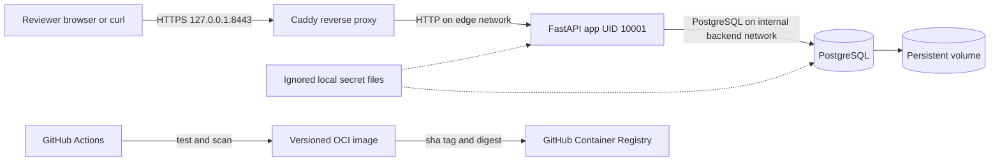

# Hospital appointment deployment architecture

The local deployment has one HTTPS entry point and no published application or database ports. Caddy forwards requests to a non-root FastAPI container. The app reaches PostgreSQL through a private Compose network and reads only the secrets it needs. PostgreSQL owns a persistent volume.

## Data rule

`appointments` holds a doctor, patient, start time, and status. A partial unique index on `(doctor_id, start_at)` where `status = 'confirmed'` is the concurrency boundary. One request can insert or reschedule a confirmed booking for a slot; a simultaneous conflicting transaction receives a PostgreSQL uniqueness error and the API returns HTTP 409. Cancelling changes the status and frees the slot. `audit_events` records each successful create, reschedule, and cancel in the same database transaction.

## Trust boundaries

The proxy publishes only loopback HTTPS. The app authenticates bearer tokens with constant-time comparison and checks patient ownership or staff role. Tokens and database passwords are mounted from ignored files. The app database role can read doctor and patient seed records and modify appointment and audit records; it cannot manage tables or roles. Request logs contain method, path, status, duration, and request ID, and omit headers and bodies. All seed patient records are synthetic.
